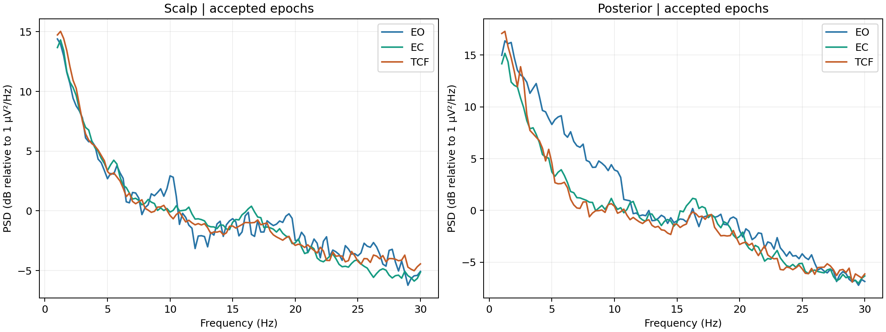
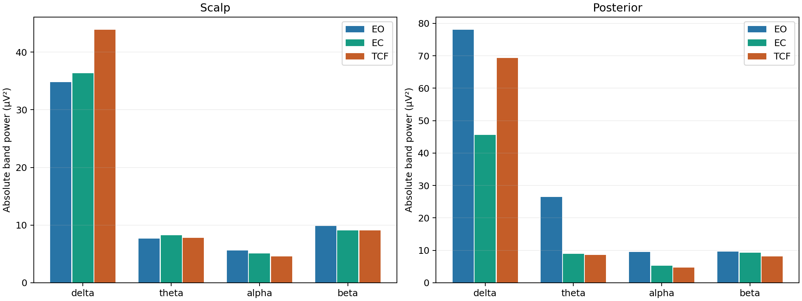

EXPLORATORY RESEARCH REPORT • REVISED WITH ACQUISITION DOCUMENTATION

# EEG spectral differences during eyes-open rest, eyes-closed rest and a TCF condition

### Single-participant, fixed-order analysis with comparison to a BrainAssistant qEEG report

Prepared 18 October 2026 | Data sources: three EDF exports and noushin.pdf | No identifying demographics reproduced.

### Abstract

**Objective.** To characterize spectral differences between a TCF-labelled intervention and eyes-closed rest, describe signal quality, and assess correspondence with a supplied automated qEEG report.

**Methods.** Three recordings from one participant in one session were analyzed in the order eyes open (EO), eyes closed (EC), and TCF. Eyes remained closed during TCF. The exports contained 24 signal channels at 256 Hz, labelled relative to CPz. The accompanying report instead lists eego / ANT hardware, a sampling-rate field of 2048 and montage M1~M2. These acquisition/export differences were documented rather than assumed resolved. Four-second epochs underwent amplitude, flatness and step screening; F3 and T8 were excluded, as were mastoid channels from scalp summaries. Mean windowed periodograms quantified delta, theta, alpha and beta power. Comparisons were descriptive, with sensitivity analyses and no participant-level inferential statistics.

**Results.** TCF versus EC showed alpha reductions of 9.7% across 20 scalp channels and 11.5% across eight posterior channels, with delta increases of 20.8% and 51.9%, respectively. Posterior alpha reductions remained 10.5-12.4% across the tested settings; posterior delta increases ranged from 29.7% to 52.9%. Scalp screening retained 40 s of EO and 196 s each of EC and TCF. The supplied report flags limited alpha reactivity and artifact concerns but supplies no intervention-specific spectral comparison.

**Conclusion.** These exports show condition-associated spectral differences, not an established TCF effect. Fixed order, a single participant, residual contamination and unresolved reference/segment differences limit interpretation. The automated qEEG report offers contextual information but does not independently validate the TCF contrast.

**Reporting status.** The existing numerical analysis is unchanged. This revision adds documented equipment information and a source-comparison audit. Results were generated in Python; the supplied equivalent R implementation remains unexecuted in this environment.

## 1. Methods: design and recording provenance

### 1.1 Design and data sources

The data provider confirmed one participant and one session, with EO first, EC second and TCF third. The intervention was reported active throughout its file, with eyes closed. EC was therefore the principal baseline for TCF; EO-EC was a secondary comparison. TCF is the supplied condition label, not an independently measured exposure. There was no randomization, sham condition or repeated block. The analysis was developed after data inspection and was not preregistered. Participant age, sex and clinical status were not inferred from placeholder information in the supplied report.

### 1.2 Documented device and software information

| Item | Supplied BrainAssistant report [1] | Analyzed EDF exports [2] |
| --- | --- | --- |
| Hardware | eego / ANT Compatibility 2021 (NA-246), exactly as listed on p. 2 | Manufacturer/model not specified in the signal headers inspected |
| Software | brainboost BrainAssistant; report version v26.05a (p. 2) | Reader and spectral code documented in the analysis package |
| Sampling rate | 2048 in the report sampling-rate field, interpreted as samples/s | 256 samples/s, derived from samples per data record and record duration |
| Reference / montage | M1~M2 (p. 2); exact reference construction not described | Signal labels end in -CPz; retained without re-referencing |
| Channels | 23 active labels, including CPz; M1/M2 appear in the montage notation | 24 signal channels, including M1/M2; CPz is the reference suffix, not a separate signal |
| Additional specifications | No confirmed ADC resolution, amplifier noise, input range, cap type, impedance or filter settings | EDF integer storage is 16-bit; this does not establish amplifier ADC resolution |

The factor-of-eight difference in sampling rates is compatible with export resampling, but the PDF does not document the transformation or its anti-aliasing filter. Neither the exact eego amplifier model nor whether NA-246 is a device identifier or configuration label can be established from this document alone. No generic manufacturer specifications have been substituted for missing session details.

### 1.3 Segment correspondence

The PDF lists EO 06:01, EC 00:13, EC 06:16 and Intervention 04:43 (p. 2). The supplied files contain 362, 377 and 284 s, respectively, with task annotations lasting approximately 361.443, 376.944 and 283.669 s. This close duration correspondence supports an association with the longer segments but is not a verified sample-by-sample mapping. The short EC file was not supplied. The PDF does not identify whether its EC summaries use the short segment, the long segment or both. Its 25:09 session duration is not the amount of EEG analyzed here.

## 2. Methods: processing and spectral analysis

### 2.1 Import and channel quality

Continuous EDF/EDF+C files were read as signed 16-bit samples and converted to microvolts using each channel's digital and physical calibration extrema [2,4]. Import checks covered file size, units, signal count and sampling rate. Annotation bytes were excluded from signal analysis. Acquisition filters and earlier processing were not reconstructed. No additional high-pass, low-pass or notch filtering was applied.

Nonoverlapping four-second epochs were screened. T8 was effectively flat in the exported reference; F3 had persistently large fluctuations (median epoch peak-to-peak amplitude approximately 422, 265 and 296 µV in EO, EC and TCF). Both channels were excluded consistently. M1 and M2 were omitted from scalp summaries. These are analytical exclusions, not diagnoses or confirmed hardware failures. Overview traces were inspected, but exhaustive manual artifact scoring and independent-component removal were not performed.

### 2.2 Epoch acceptance and regional definitions

The first and last complete epoch of each file were removed; incomplete trailing samples were discarded. An epoch was rejected if any included channel had peak-to-peak amplitude >150 µV, sample standard deviation <0.1 µV, or an adjacent-sample step >50 µV. The scalp summary used 20 channels: Fp1, Fp2, F7, Fz, F4, F8, C3, Cz, C4, P3, Pz, P4, O1, O2, T7, P7, P8, F9, F10 and Oz. The posterior summary used P3, Pz, P4, P7, P8, O1, Oz and O2. Each region used its own all-channel acceptance mask; posterior and scalp estimates therefore represent different accepted time segments. Passing these thresholds does not establish artifact-free EEG.

### 2.3 Power spectral estimation

Each accepted epoch was demeaned and multiplied by a periodic Hann window. A 1,024-point FFT yielded 0.25 Hz frequency spacing. Squared Fourier magnitudes were normalized by sampling rate times the sum of squared window weights, with positive-frequency bins doubled except at Nyquist. One-sided PSDs (µV²/Hz) were averaged arithmetically over accepted epochs within each channel [3,5]. No zero-padding or epoch overlap was used.

Absolute band power was the sum of PSD bins times 0.25 Hz over delta [1,4), theta [4,8), alpha [8,13) and beta [13,30) Hz. The upper endpoint is excluded to avoid double-counting. Relative power was band power divided by total [1,30) Hz power, multiplied by 100, for each channel. Regional values are means of channel absolute powers and, separately, means of channel relative percentages. They are not spectra of channel-averaged waveforms. No source localization, normative z-scores, connectivity or cognitive-performance scores were calculated.

### 2.4 Contrasts, sensitivity and statistical scope

TCF-EC and EC-EO contrasts were computed as 100 × (comparison/baseline - 1), with dB ratios and relative-power percentage-point differences also exported. Sensitivity analyses used a 100 µV threshold, the first 280 s of every condition before boundary exclusions, and inclusion of boundary epochs with artifact rejection retained. Equal observation windows do not guarantee equal accepted data. No p-values or population confidence intervals were calculated: epochs and electrodes are not independent participant replicates.

## 3. Results: spectral differences and retained data

Table 1. Absolute power in EC and TCF, averaged across accepted epochs and then channels. Changes are descriptive; no statistical significance is implied.

| Region / band | EC (µV²) | TCF (µV²) | TCF vs EC |
| --- | --- | --- | --- |
| Scalp / delta | 36.35 | 43.90 | +20.8% |
| Scalp / theta | 8.23 | 7.81 | -5.1% |
| Scalp / alpha | 5.09 | 4.60 | -9.7% |
| Scalp / beta | 9.07 | 9.06 | -0.1% |
| Posterior / delta | 45.63 | 69.32 | +51.9% |
| Posterior / theta | 8.99 | 8.60 | -4.4% |
| Posterior / alpha | 5.25 | 4.65 | -11.5% |
| Posterior / beta | 9.26 | 8.17 | -11.7% |

Table 2. Retained data in the main analysis. Candidate epochs exclude the first and last complete four-second epochs.

| Condition | Recorded | Candidates | Scalp accepted | Posterior accepted |
| --- | --- | --- | --- | --- |
| EO | 362 s | 88 | 10 (40 s; 11.4%) | 55 (220 s; 62.5%) |
| EC | 377 s | 92 | 49 (196 s; 53.3%) | 78 (312 s; 84.8%) |
| TCF | 284 s | 69 | 49 (196 s; 71.0%) | 60 (240 s; 87.0%) |

Figure 1. Mean accepted-epoch spectra. Alpha is not a prominent narrow peak in the eyes-closed spectra. Scalp and posterior panels use different channel sets and acceptance masks.

Only 40 s of EO passed the scalp-wide screen, making EO comparisons especially sensitive to segment selection. Posterior alpha was 9.53 µV² in EO and 5.25 µV² in EC (-44.9%). This is a finding of this pipeline, not evidence of a clinical abnormality.

## 4. Results: sensitivity to analysis choices

Figure 2. Absolute delta, theta, alpha and beta powers for EO, EC and TCF. Bar heights are descriptive summaries; no population uncertainty is represented.

Table 3. Sensitivity of TCF-EC percentage changes to screening and recording-window choices.

| Analysis setting | Scalp alpha | Posterior alpha | Posterior delta |
| --- | --- | --- | --- |
| Primary: 150 µV | -9.7% | -11.5% | +51.9% |
| Stricter: 100 µV | -11.5% | -12.4% | +29.7% |
| First 280 s per condition | -11.3% | -10.5% | +42.8% |
| Boundary epochs included | -9.7% | -11.8% | +52.9% |

### 4.1 Absolute and relative changes

Posterior relative alpha was 8.47% in EO, 7.78% in EC and 5.11% in TCF. The TCF-EC relative-alpha change is -2.67 percentage points; it differs from the -11.5% change in absolute alpha power. The proportion of alpha depends on other bands in its denominator, including delta. These quantities should not be interchanged.

### 4.2 Robustness and uncertainty

The sign of the alpha reduction persisted across the tested thresholds and time windows. This supports limited analytical robustness within the existing exports, not reproducibility across sessions or participants. Delta was more sensitive to the screening threshold: posterior increases ranged from 29.7% to 52.9%. Residual slow drift, eye activity and movement remain possible contributors because the analysis used numerical epoch screening without dedicated EOG correction or additional filtering.

These settings are not independent experiments. Agreement among sensitivity runs cannot resolve order effects, expectancy, reference differences or errors already present in the exported signals.

## 5. Is the supplied qEEG PDF consistent with this analysis?

**Only partly.** It provides useful equipment provenance and broadly compatible quality warnings. It does not contain an intervention-specific spectral contrast, and several methodological differences prevent direct numerical validation.

| Topic | Evidence in noushin.pdf [1] | Assessment relative to EDF analysis |
| --- | --- | --- |
| Intervention results | Intervention appears in the segment list (p. 2). Displayed spectra and maps are labelled EO or EC. | No TCF-EC values are supplied; the report neither confirms nor refutes the TCF contrast. |
| Alpha reactivity | Alpha Regulation Score = 0; based on relative parietal alpha, 8-12 Hz (p. 23). | Qualitatively compatible with weak relative alpha enhancement. It is not confirmation of the same absolute-alpha measurement. |
| Artifact concerns | EMG Artifact Score = 0; its accompanying text flags high-frequency contamination concerns (p. 28). | Consistent with a need for caution, but our screen did not independently identify or quantify muscle activity. |
| Absolute EO-EC amplitudes | At Pz, alpha amplitude is listed as 4.1 µV in EO and 15.4 µV in EC (pp. 13-14). | These are amplitudes, not our integrated power. They do not demonstrate agreement with our EO-EC power reduction; normalization and segment matching are needed. |
| Reference and sample rate | M1~M2 and 2048 are reported (p. 2). | Exports are labelled -CPz and contain 256 samples/s. These are material provenance differences. |
| T8 channel | A nonzero EC T8 spectrum is displayed (p. 48). | T8 is effectively flat in the supplied exports. Re-referencing, segment choice or export/channel handling could contribute; the cause is unresolved. |
| EC segment identity | Two EC segments are listed: 00:13 and 06:16 (p. 2). | Only the long EC export is available. The PDF does not clearly map its EC calculations to one or both segments. |
| Band definitions | Alpha 8-12 Hz; beta 12-20 Hz, with separate high beta 20-35 Hz (p. 7). | Our alpha is 8-13 Hz and beta 13-30 Hz. These band powers are not directly interchangeable. |

The PDF also uses a preliminary proprietary normative database (p. 8) and supplies wellness/neurofeedback scores. Those scores were not reproduced and are not intervention outcomes. A zero score is not evidence of zero brain activity, nor does it independently establish a diagnosis or impaired ability.

## 6. Interpretation and conclusion

### 6.1 Interpretation of the TCF-EC comparison

Within the analyzed exports, TCF was associated with modestly lower alpha power and higher low-frequency power than the preceding EC block. Neither band identifies a unique mental state or mechanism. In particular, increased measured delta should not be described as healing, deeper consciousness or a beneficial response. Artifact contamination and changes over time remain unresolved alternatives. No benefit or harm can be inferred from these descriptive contrasts.

The relatively stable alpha reduction is the most consistent spectral observation across the implemented sensitivity checks. Its stability does not remove the fixed-order confound: TCF occurred later in the session. Changes in vigilance, attention, posture, eye activity or expectancy were not measured independently. No inference about the existence or mechanism of a consciousness field follows from these results.

### 6.2 What the new PDF changes

The acquisition description can now identify the reported hardware and software. More importantly, the PDF reveals a different reference montage, a different sampling rate and an additional EC segment. These are reasons to strengthen the provenance limitations in the report, not to overwrite the verified EDF metadata or retroactively claim that the original calculations used a mastoid reference at 2048 Hz.

A nonzero mastoid-referenced T8 trace is not, by itself, proof that an effectively flat CPz-labelled T8 export is valid. Reference transformations can contribute signal to a re-referenced trace. The actual transformation history and original continuous data are needed to resolve this discrepancy. Similarly, the PDF's relative-alpha regulation score can coexist with increased listed absolute amplitudes; relative and absolute quantities answer different questions.

### 6.3 Relation to the previously supplied poster

The poster described early reductions in delta, theta, alpha and beta across a group of 44 participants. The current exports agree directionally for alpha and theta, show region-dependent beta changes, and show delta in the opposite direction. The poster's task windows, channel configuration and group design differ from this single-person analysis. This is partial directional overlap, not a replication. The new qEEG PDF supplies no additional TCF comparison that resolves that difference. [6]

### 6.4 Conclusion

**In this single-participant, fixed-order sequence, the TCF-labelled recording showed lower alpha power and higher delta power than the preceding eyes-closed baseline under the specified export-level analysis. These observations remain provisional because of signal-quality limitations, absent repeated or sham blocks, and unresolved differences between the acquisition report and exported data. The supplied qEEG report supports selected quality concerns but does not independently validate the TCF findings.**

## 7. Reproducibility, unresolved details and source notes

### 7.1 Executed analysis and available code

The completed calculations and figures were produced by validation/analyze_python.py using Python 3.12.14, NumPy 2.3.5, SciPy 1.17.0 and Matplotlib 3.10.8. The existing repository includes EDF readers, channel and epoch quality tables, band powers, contrasts, sensitivity analyses, and header-redacted data copies. Original files were not modified. A 10 Hz sinusoid with 10 µV peak amplitude yielded the expected alpha power of 50 µV², and an independent FFT normalization calculation agreed within approximately 1.14 × 10^-13. These checks support numerical scaling, not physiological validity.

The equivalent base-R script, R/analyze.R, can perform the analysis without Python or contributed R packages. R was unavailable during execution; that implementation has not been run here. validation/validate_R.R is provided to compare a local R run with the executed Python reference. The numerical results in this revised PDF have not been recalculated or changed. The rebuilt repository includes this revised PDF and an editable Markdown manuscript. Original numerical outputs are preserved; the new provenance review does not change their preprocessing or reference.

### 7.2 Information needed before stronger claims or publication

Obtain the original continuous recording and software processing/export settings; confirm which EC segment(s) the vendor report analyzed; document the 2048-to-256 sampling-rate transformation and anti-aliasing filter; reconcile M1~M2 with the -CPz labels; inspect T8 and F3 in the acquisition data; and document artifact rejection, amplitude normalization and relative-power denominators. A matched-method comparison should use the same reference, bands, segments and acceptance masks, with manual quality review where feasible.

A manuscript also requires verified participant characteristics, consent and ethics information, exact intervention instructions, acquisition filters, electrode/cap information and impedance criteria. Those details were not invented. For causal evaluation, use repeated and randomized or counterbalanced EC, TCF and suitable control/sham blocks, independent artifact/vigilance monitoring, and additional participants.

### 7.3 Sources and document-level citations

[1] Supplied document: noushin.pdf, 53 pages, qEEG Report powered by brainboost BrainAssistant, version v26.05a. Key pages: 2 (hardware and segments); 6 and 8 (scope/database); 7 (bands); 13-14 (Cz/Pz amplitudes); 23 (alpha regulation); 28 (artifact score); 48 (T8). Page numbers refer to the PDF page count. Interpretive claims from the vendor text were not adopted as established findings.

[2] Supplied EDF files: recording_1_EO.edf, recording_3_EC.edf, recording_4_Intervention.edf. Condition order and eye state were confirmed by the data provider.

[3] Rebuilt analysis repository, EEG_GitHub_Repository_v2.zip: methods, executed Python code, unexecuted R implementation, output CSV files and validation records. Tables and figures in this report derive from those existing outputs.

[4] EDF and EDF+ format specifications: https://www.edfplus.info/specs/edf.html and https://www.edfplus.info/specs/edfplus.html.

[5] SciPy periodogram documentation: https://docs.scipy.org/doc/scipy/reference/generated/scipy.signal.periodogram.html. R FFT documentation: https://search.r-project.org/R/refmans/stats/html/fft.html.

[6] Previously supplied poster image: Empirical Investigation of T-Consciousness Fields: EEG and MRS Evidence for Non-Physical Modulation of Neural Activity and Metabolism. Comparison is to the poster as supplied, not a reanalysis of its underlying study data.

## Appendix A. Overview of signal-quality concerns

Figure A1. Selected raw channels, median-centred and vertically offset by 250 µV for display. F3 shows persistent high-amplitude fluctuations, while T8 is effectively flat in these exported traces. Brief large transients are evident in all conditions. Display sampling is reduced for readability; quality screening used the full-resolution samples.

The trace overview is a technical quality illustration, not a clinical EEG interpretation. F3 and T8 were excluded from all comparative summaries; M1 and M2 were excluded from scalp summaries. No channel interpolation was performed. The downloadable repository contains the full per-channel quality metrics and every epoch-acceptance decision.

The report is descriptive and exploratory. Neither the vendor wellness scores nor this spectral analysis establishes a diagnosis, a treatment indication or an intervention mechanism.
